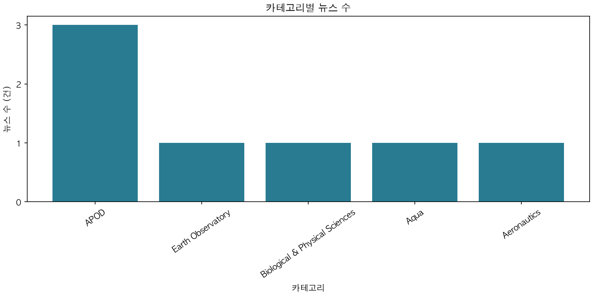
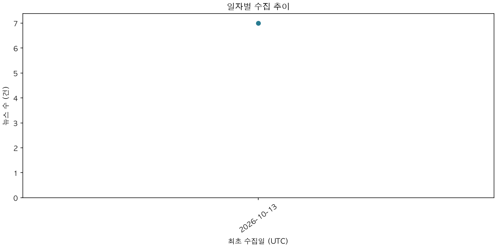

# AI 뉴스 종합 리포트

생성 시각: 2026-10-13T04:48:36+00:00
필터 (발행일 UTC): {}
대상 뉴스: 7건

## 품질 지표

- 원본 수집: 10건 / 정제 처리: 10건 / 대기: 0건
- 정제 거부율 (필수 필드 누락·잘못된 날짜/URL): 0.0%
- 중복률 (skip 및 upsert 포함): 30.0%
- 요약 완료율: 100.0%
- 정제 거부율·중복률은 전체 raw 처리 건수 기준, 요약 완료율은 현재 필터의 clean 뉴스 기준입니다.
- 분모가 0인 지표는 0.0%로 표시합니다.

## TOP 5 카테고리

- APOD: 3건
- Earth Observatory: 1건
- Biological & Physical Sciences: 1건
- Aqua: 1건
- Aeronautics: 1건

## AI 인사이트

분석 ID: 1 / 생성: 2026-10-13T04:48:33+00:00 / 모델: gemini-2.5-flash
분석 표본: 7건 / 현재 대상: 7건
기사 ID: 6, 7, 1, 2, 3, 4, 5

### 주요 트렌드
- 우주 탐사 및 심층 과학 연구 확장: 국제우주정거장(ISS)을 통한 인간 및 식물 건강 연구, 목성 위성 관측, 그리고 우주 중성미자 검출 등 다양한 우주 과학 분야의 탐사가 활발히 진행되고 있습니다.
- 지구 환경 변화 모니터링 및 지질학적 현상 연구: 남극 해빙의 지속적인 감소 추세가 관찰되며, 랜드샛 위성을 통해 운석 충돌 구조와 같은 지구 지질학적 특성들이 분석되고 있습니다.
- 첨단 기술을 활용한 과학적 발견: 아이스큐브 중성미자 관측소와 같은 대규모 시설을 통해 우주의 근원을 탐구하며, 중요한 과학적 발견이 노벨상으로 인정받는 등 기초 과학 분야의 진보가 두드러집니다.
- 대중과의 소통을 통한 과학 및 우주 탐사 홍보: NASA는 NFL 경기와 같은 대중적 행사에 참여하여 아르테미스 프로그램 등 주요 우주 탐사 미션을 홍보하고 대중의 관심을 유도하고 있습니다.

### 핵심 키워드
- 우주 탐사
- 국제우주정거장 (ISS)
- 건강 연구
- 남극 해빙
- 기후 변화
- 천문학
- 중성미자
- 운석 충돌
- 지구 관측
- 대중 소통
- NASA
- 아르테미스 프로그램

### 시사점
- 국제우주정거장(ISS)에서의 생명 과학 연구는 미래 장기 유인 우주 탐사 미션(예: 화성 탐사)을 위한 필수적인 토대를 마련하고, 우주 환경이 인체 및 생물에 미치는 영향을 이해하는 데 기여합니다.
- 남극 해빙의 지속적인 감소 추세는 기후 변화의 가속화를 시사하며, 이는 전 지구적인 환경 문제 해결을 위한 지속적인 연구와 정책 마련의 중요성을 강조합니다.
- 우주 중성미자 검출과 같은 기초 과학 분야의 발전은 우주의 근원적인 질문에 답하고 인류의 지식 지평을 확장하는 데 핵심적인 역할을 하며, 노벨상 수상과 같은 성과는 과학적 노력의 중요성을 부각합니다.
- NASA의 대중 참여 활동은 과학 기술에 대한 일반 대중의 관심을 높이고, 특히 젊은 세대에게 STEM 분야 진로에 대한 영감을 제공하여 미래 과학 발전의 지속 가능성을 높이는 데 중요한 역할을 합니다.

## 차트

중복 제거한 뉴스의 최초 수집일(UTC)을 집계합니다. 날짜 필터는 발행일에 적용됩니다.

## 기사 출처

- [6] APOD: 2026 October 13 – Desert Stairway to Heaven | https://science.nasa.gov/image-article/apod-2026-october-13-desert-stairway-to-heaven/
- [7] An Impact Structure With Legs | https://science.nasa.gov/earth/earth-observatory/an-impact-structure-with-legs/
- [1] NASA’s SpaceX CRS-35 Mission to Launch Health Research | https://science.nasa.gov/missions/station/nasas-spacex-crs-35-mission-to-launch-health-research/
- [2] APOD: 2026 October 12 – Jupiter and the Moons | https://science.nasa.gov/image-article/apod-2026-october-12-jupiter-and-the-moons/
- [3] Antarctic Sea Ice Grows to Its 2026 Maximum | https://science.nasa.gov/earth/earth-observatory/antarctic-sea-ice-grows-to-its-2026-maximum/
- [4] APOD: 2026 October 11 – Ice Fishing for Cosmic Neutrinos | https://science.nasa.gov/image-article/apod-2026-october-11-ice-fishing-for-cosmic-neutrinos/
- [5] NASA to Conduct Flyover, Engage NFL Fans at MetLife Stadium | https://www.nasa.gov/news-release/nasa-to-conduct-flyover-engage-nfl-fans-at-metlife-stadium/
