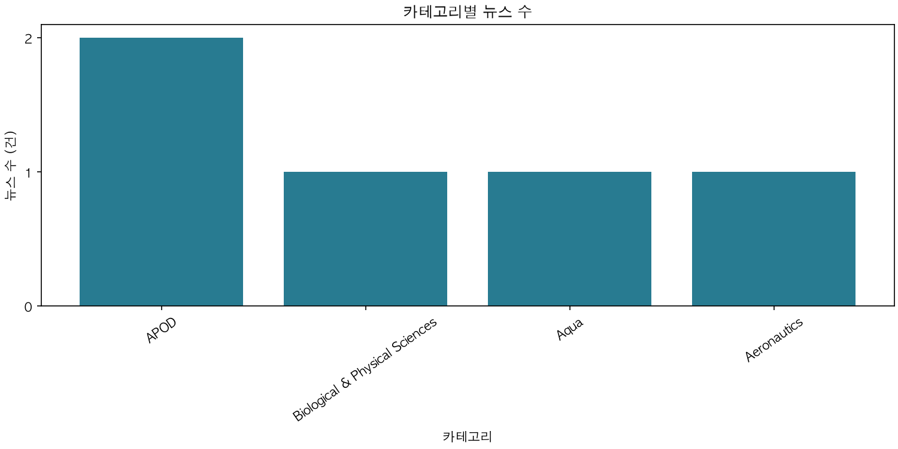
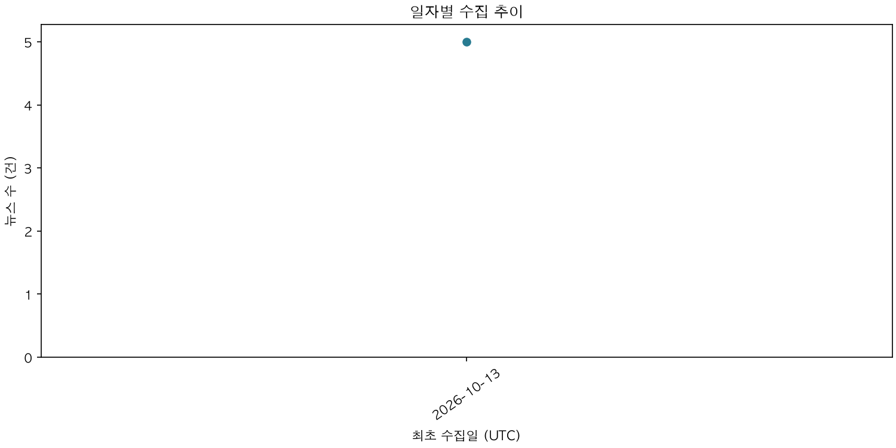

# AI 뉴스 종합 리포트

생성 시각: 2026-10-13T04:40:34+00:00
필터 (발행일 UTC): {}
대상 뉴스: 5건

## 품질 지표

- 원본 수집: 5건 / 정제 처리: 5건 / 대기: 0건
- 정제 거부율 (필수 필드 누락·잘못된 날짜/URL): 0.0%
- 중복률 (skip 및 upsert 포함): 0.0%
- 요약 완료율: 100.0%
- 정제 거부율·중복률은 전체 raw 처리 건수 기준, 요약 완료율은 현재 필터의 clean 뉴스 기준입니다.
- 분모가 0인 지표는 0.0%로 표시합니다.

## TOP 5 카테고리

- APOD: 2건
- Biological & Physical Sciences: 1건
- Aqua: 1건
- Aeronautics: 1건

## AI 인사이트

동일한 기간·카테고리 조건으로 저장된 AI 분석이 없습니다. analyze를 먼저 실행하세요.

## 차트

중복 제거한 뉴스의 최초 수집일(UTC)을 집계합니다. 날짜 필터는 발행일에 적용됩니다.

## 기사 출처

- [1] NASA’s SpaceX CRS-35 Mission to Launch Health Research | https://science.nasa.gov/missions/station/nasas-spacex-crs-35-mission-to-launch-health-research/
- [2] APOD: 2026 October 12 – Jupiter and the Moons | https://science.nasa.gov/image-article/apod-2026-october-12-jupiter-and-the-moons/
- [3] Antarctic Sea Ice Grows to Its 2026 Maximum | https://science.nasa.gov/earth/earth-observatory/antarctic-sea-ice-grows-to-its-2026-maximum/
- [4] APOD: 2026 October 11 – Ice Fishing for Cosmic Neutrinos | https://science.nasa.gov/image-article/apod-2026-october-11-ice-fishing-for-cosmic-neutrinos/
- [5] NASA to Conduct Flyover, Engage NFL Fans at MetLife Stadium | https://www.nasa.gov/news-release/nasa-to-conduct-flyover-engage-nfl-fans-at-metlife-stadium/
